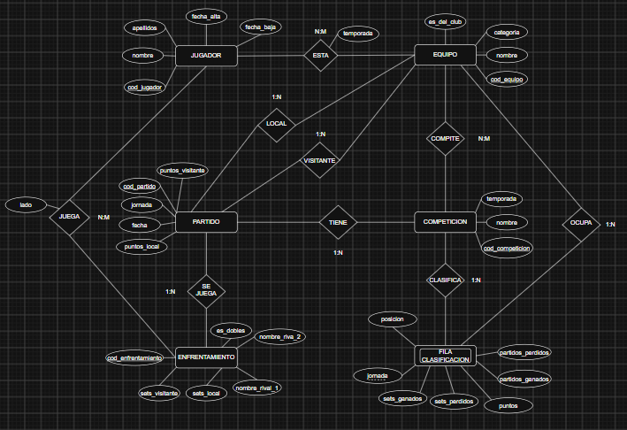

# Club de Tenis de Mesa · App de gestión

Aplicación para seguir la actividad de un club de tenis de mesa: jugadores, equipos, resultados de liga y un resumen semanal con la evolución de cada equipo en la clasificación.

Es mi proyecto personal de 1º de DAM. Lo voy ampliando a medida que avanzo en el curso.

> Los datos de este repositorio son **inventados**. Los datos reales del club no se suben nunca (RGPD).

## Estado actual

- [x] Diseño de la base de datos (diagrama entidad-relación)
- [x] Validación de resultados de un encuentro (6-0, 5-1, 4-2 y 4-3 con dobles)
- [x] Cálculo de puntos de liga por encuentro (3-0 o 2-1)
- [ ] Menú en consola con varios partidos
- [ ] Clasificación por equipo
- [ ] Resumen semanal con flechas (↑ ↓ =)
- [ ] Guardar datos en archivo y después en base de datos
- [ ] Interfaz gráfica

## Reglas de la liga

Cada encuentro se juega entre dos equipos de 3 jugadores: 6 partidos individuales al mejor de 5 sets. Si quedan 3-3, se juega un dobles que decide el encuentro 4-3.

| Resultado | Puntos ganador | Puntos perdedor |
| --- | --- | --- |
| 6-0 / 5-1 | 3 | 0 |
| 4-2 / 4-3 | 2 | 1 |

## Diseño

## Cómo ejecutarlo

Requiere Java 17 o superior. Abre el proyecto en IntelliJ IDEA y ejecuta `src/Puntuacion.java`.

## Tecnologías

- Java
- IntelliJ IDEA
- draw.io (diseño)

## Autor

Alejandro López Soler · 1º DAM
